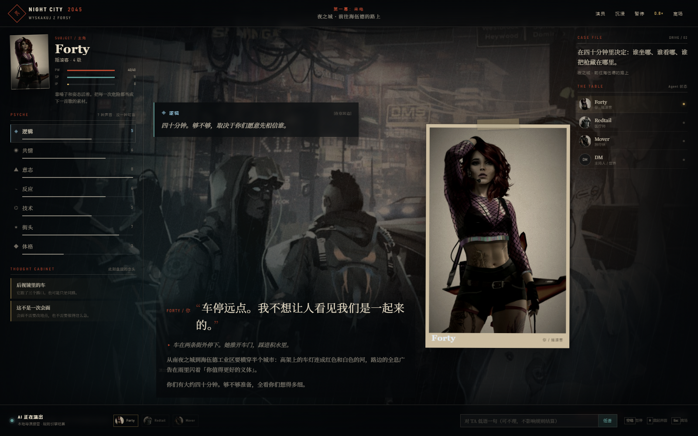
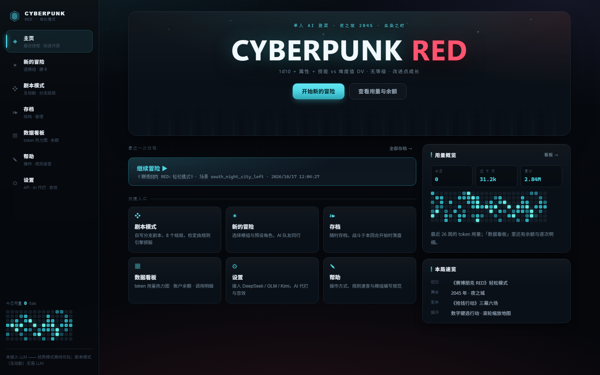
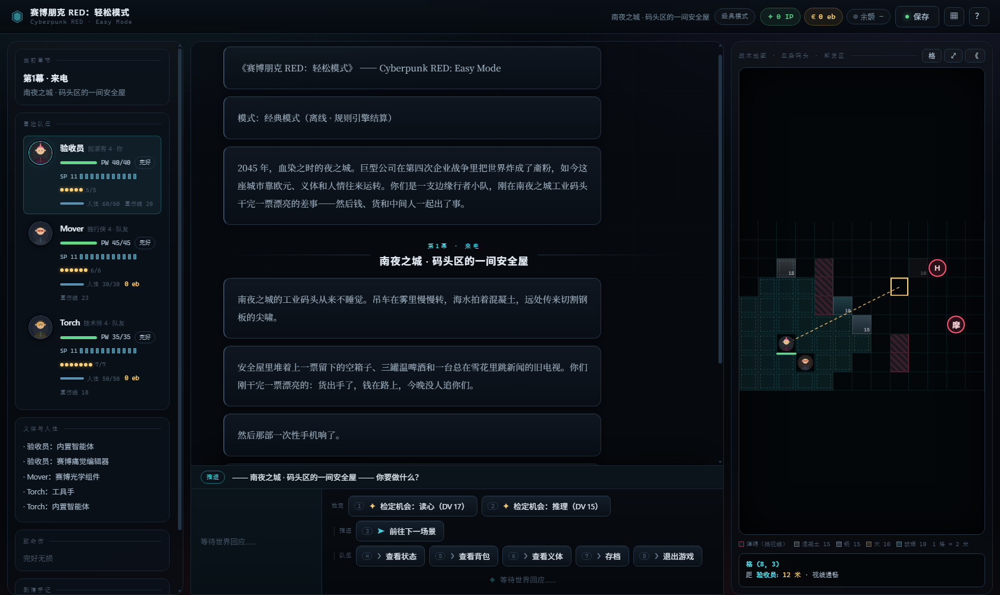
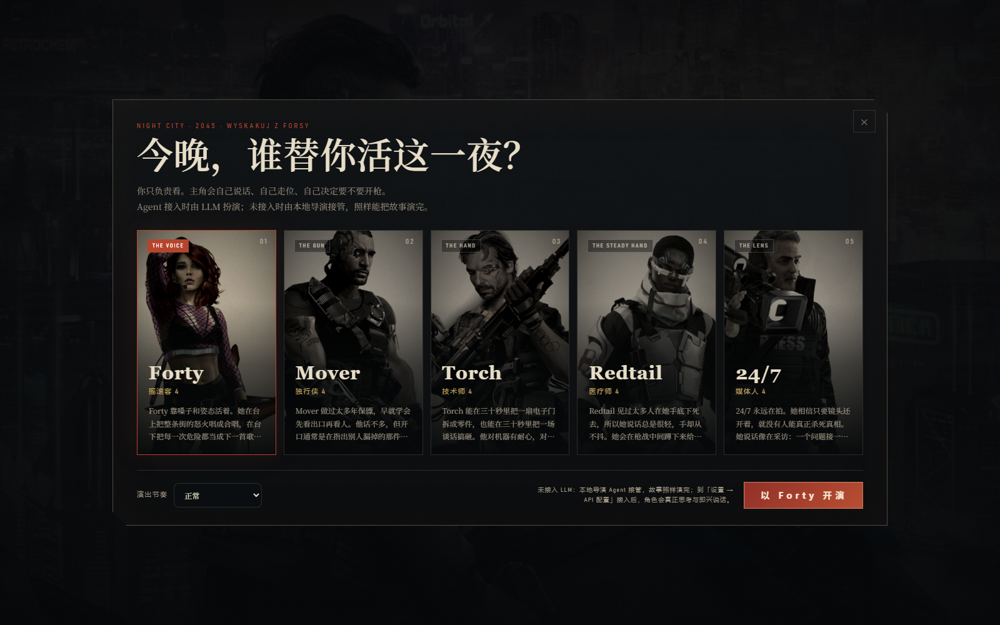
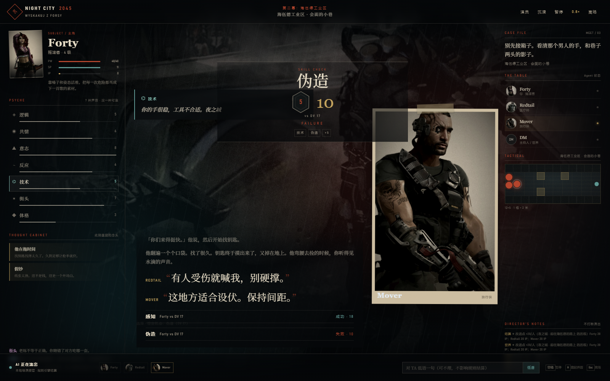
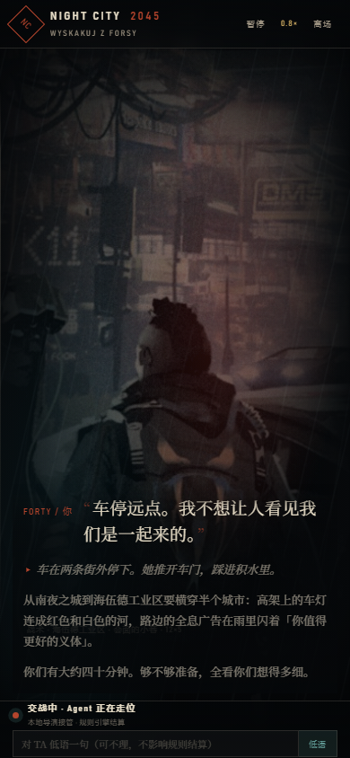
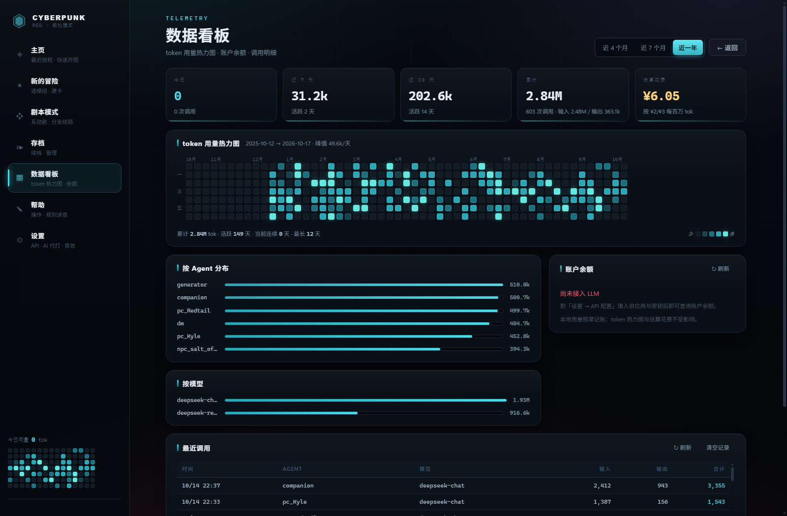

# TRPG —— 单人 AI 跑团（《赛博朋克 RED》）

一个可以**单人游玩**的桌面角色扮演游戏。DM 与同桌的其他角色都由 AI Agent 扮演，
舞台是 **2045 年（血染之时）的夜之城**，规则是
**《赛博朋克 RED》（Cyberpunk RED）**——以免费入门的**轻松模式（Easy Mode）**口径为准
（引擎版本 `trpg` 2.3.1，存档 `ruleset = "cyberpunk-red"`）。

你要做的只有一件事：接下这单活，然后活着把钱拿到手。

- **规则**：《赛博朋克 RED》轻松模式全集——**十项属性 + 41 项技能**的技能检定
  （`1d10 + 属性 + 技能` 对抗难度值）、暴击成功/失败、幸运点、按射程带查表的远程战斗、
  白刃战无视一半护甲、斗殴两连击与擒抱/锁喉/投掷、护甲 SP 与磨损、
  **致命伤**（两颗 6 触发 + 2d6 表）、伤势等级、生存检定、稳定与急救固定/治疗、
  掩体与对峙、义体与人性、**改进点（IP）**成长。
  所有骰点由规则引擎完成，LLM 只做决策与叙述，**不生成任何数值结果**。
  未收录的子系统**一律不实现**（见下文"明确未实现"——这是一句可被检验的保真声明）。
- **演出**：每次检定与攻击都有 **1d10 掷骰动画**（掷出 10 金色爆辉、掷出 1 震裂）；
  **合成音效**（骰子/命中/暴击/致命伤/倒地/终局，Web Audio 实时生成，零外部音频文件）；
  队伍头像程序化生成；终幕结算卡与首团新手引导。
- **AI 剧场（纯 AI 跑团）**：不用建卡、不用读规则、不用出手。挑一位主角，
  每个 PC（主角与队友）都由独立 Agent 自主走位、说话、决定要不要开枪；界面按
  《极乐迪斯科》的叙事语法重做——**技能之声**（逻辑/共情/意志/反应/技术/街头/
  体格会在脑内插话）、案卷式角色肖像、全屏场景底片、检定的判决叠层、AI 考虑过
  的选项、案卷任务栏、战术板与环境音。可暂停、调速、隐藏 UI，或对主角低语一句
  （不保证被采纳）。**纯 AI：必须先接入 LLM，没有本地导演/剧本兜底**。
  详见 [docs/cinema-design.md](docs/cinema-design.md)。
- **剧本**：内置**唯一一部**模组——轻松模式手册本身
  **《赛博朋克 RED：轻松模式》**（`cpred-easy-mode`，*Cyberpunk RED: Easy Mode*），
  内含手册的入门差事**「抢钱行动」**（原文 *WYSKAKUJ Z FORSY*）：
  三幕六场，从南夜之城的安全屋一路打到码头仓库。
  此前的 5e 模组（蓝色守望之塔 / 星坠矿脉 / 盐雾灯塔 / 雾门客栈 / 余烬之门等）
  **已全部移除**。支持 AI 一键生成模组与粘贴 JSON 导入；开发规范见
  根目录 [MODULE_SPEC.md](MODULE_SPEC.md)。
- **队友由剧本决定**：模组自带**五名预设角色**（`pregens`）——摇滚客 Forty、
  独行侠 Mover、技术师 Torch、医疗师 Redtail、媒体人 24/7。
  **人名一律是英文**（手册卡面上的街头名原名；叙述正文才是中文，不做音译），
  **地名与类型标签保持中文**（夜之城、海伍德；腐败警察、摩托增援、线人），
  新写或 AI 生成的模组也照这个口径。
  玩家挑一位当自己，其余按你的选择由 AI 代打（默认队友：医疗师 Redtail + 独行侠 Mover）。
- **桌边社交层（AI 模式）**：队友是桌边的活人——你的话音未落，他们可能**抢话**打断
  （终端 `（抢话）` 标记 / 网页"抢话"徽标）；DM 叙述后各自决定开口或沉默；
  意见相左时会进入多轮**辩论**（申辩/反驳/让步）；同伴们交谈过后，DM 会让 NPC
  即席接话、反驳或裁定。战斗中队友也会先喊一句战吼再动手。
  LLM 不可达时整层静默降级，绝不阻塞对局。
- **Agent 循环**：参考 [deepseek-harness](https://github.com/deepseek-ai/deepseek-harness)
  的"一切皆插件"架构，详见 [HARNESS.md](HARNESS.md)。

## 快速开始

要求：Python 3.10+，**无需安装任何第三方依赖**（零依赖、离线可玩）。

```bash
python main.py --web
# 或双击 启动游戏.bat（Windows）/ 启动游戏.sh（macOS/Linux）
# 打开 http://127.0.0.1:8500 （自动打开浏览器；--port 可改端口，--no-open 不自动打开）
```

**开始页**（左侧导航栏 + 右侧视图区）有七个入口：

- **AI 剧场**（纯 AI 跑团）：最省事的一条路。选一位预设角色与演出速度，
  每个 PC 由独立 Agent 自主行动，你只负责看。必须先接入 LLM；没有 LLM 时
  剧场会拒绝开局，不会退回本地导演。界面是《极乐迪斯科》式的技能之声/案卷
  肖像/检定判决叠层，而不是仪表盘。
- **剧本模式**（互动剧）：分支选择 · 多结局。内置剧本《抢钱行动》——同一部轻松模式
  手册的入门差事，改写成 70 个节点、**8 个结局**的节点图。不需要 LLM 也能玩，
  详见下文「剧本模式」。
- **新的冒险**：选择模组（内置《赛博朋克 RED：轻松模式》、AI 生成或导入的原子模组，
  Cordis 式注册表原子化加载），进入角色创建；规范见
  [MODULE_SPEC.md](MODULE_SPEC.md)。
- **角色创建**（四步，**不掷骰、无属性点池**）：
  ① 选模组 → ② 从该模组的预设**角色卡**里挑一位（轻松模式的建卡方式）
  → ③ 给自己的角色起名 → ④ 可选：从剩下的预设角色里挑几位当 AI 队友
  （默认启用模组的 `default_companions`）→ 开团。
  引擎不提供掷骰建卡，也没有属性点分配或出身选择一说——轻松模式的建卡方式就是挑一张卡。
- **存档**：继续上次的旅程（存档记录所属模组与 `ruleset`，非 `cyberpunk-red`
  的旧存档会被拒绝加载并提示不兼容）。
- **数据看板**：token 用量热力图（GitHub 贡献图式，按日聚合、跨年不丢）、
  账户余额、按 Agent / 模型的分布与逐次调用明细。详见下文「用量热力图与账户余额」。
- **帮助 / 设置**：玩法速查；API 配置（DeepSeek 默认 / 智谱 GLM / Kimi / MiniMax /
  自定义，OpenAI 兼容协议；密钥只存内存或环境变量）；音效开关与音量（保存在本浏览器）；
  Token 用量概览（按 Agent 记账，持久化在 `saves/token_usage.json`）。

对局界面（**单层暗色仪表盘**：夜之城暗玻璃 + 霓虹青/品红/琥珀三语义色，数字一律等宽）：

- **顶栏**：模组名、章节面包屑、模式徽标（剧本互动剧 / AI 模式 / 经典模式）、IP 与欧元、
  **账户余额芯片**（点开数据看板）、**随时存档按钮**（战斗中会在本回合开始时落盘）、
  「▦」数据看板与「？」操作速查。
- **左栏**：当前章节、冒险队伍（PW / 护甲 SP / 幸运 / 人性 / 重伤线 / 状态标签）、
  义体与人性、致命伤、剧情手记。**点任意队员打开「作战卷宗」**——十项属性、技能等级、
  武器、义体、人生之路一屏看完。
- **中栏**：编年史以「跑团手记」风格呈现 DM 叙述、NPC 对话、骰子检定明细卡与战况板。
  掷骰有 1d10 动画与合成音效；致命伤按 2d6 表以窄条呈现；DM 裁定期间有呼吸指示器。
- **右栏：战术地图 dock（自研 VTT，1 格 = 2 米）**：由模组的 `map` 声明直接绘制——
  障碍格（**阻挡视线**）、掩体格（**挡子弹但不挡视线**，带材质配色与剩余耐久）、
  角色与敌人棋子（含血条）、队伍落点。支持滚轮缩放、拖动平移、**悬停量距与射程判定**
  （显示距离、视线是否被挡、每种武器的射程带 DV），轮到移动时**点图落子**，
  可达范围以青色虚线格点亮。没有地图的场景自动收起该栏。
- **底部行动坞**：左边是当前行动者的头像 / PW / 护甲 SP，中间一行是当前情境，
  右边是分组的行动按钮——**检定 · 推进 · 战斗 · 支援 · 移动 · 队伍**，
  可按数字键 `1`–`9` 直接选。战斗时顶部显示**动作经济槽**（移动动作 / 其他动作 / 附赠 / 反应）。
- 刷新/断线自动回放全部事件；"放弃本局"可重开；冒险结束（通关或全灭）进入终幕结算卡。

深链：`?view=stats` 直接打开某个大厅视图（`home` / `new` / `story` / `saves` /
`stats` / `help` / `settings`），`?tour=0` 跳过开场引导。

## AI 剧场：一桌全 AI 的跑团



剧场里没有人类玩家。你选一个主角，然后看这一桌 Agent 把夜之城演完：

- **每个 PC 都是自主 Agent**：主角与同伴各有独立的 Agent、`pc_session`、人设与
  目标；探索时轮流决定说什么、做什么，战斗时各自行动。不是“一个主角 + 反应式
  队友”，也不是真人桌边模拟——PC 直接以角色身份说话和行动。
- **全 AI 探索回合**：`PartyDirector` 每场给每个 PC 最多四轮自主行动；
  `say / explore_intent / explore_act / hold` 是它们仅有的自我行动工具。
  世界裁定仍由 DM 做，PC 不能直接改场景。
- **DM 是唯一的世界 Agent**：`dm_agent` 持有叙述、检定、换场、开战等世界工具；
  NPC 是它的子智能体（`NPCDirector`），只通过 `npc_dialogue` 被拉起，工具面
  只有 `say`，不能自主行动。
- **技能之声**：逻辑/共情/意志/反应/技术/街头/体格七个声部会根据当前场景、
  检定结果和 NPC 台词插话。它们不是系统提示，而是带偏见、会误读、会逞强的
  内心声音；由 `trpg/game/psyche.py` 本地生成，零 token，不参与结算。
- **案卷式舞台**：五名预设角色的官方角色画被处理成案卷照片；六张场景底片
  （安全屋/路上/小巷/血房间/仓库/黎明）以低饱和、冷影暖高光、颗粒与雨幕统一；
  对话以「记忆栈」推进，最新一句最亮，旧句退到背景。
- **检定的判决感**：每次技能检定弹出 SKILL CHECK 叠层：声部、d10、合计、
  难度值、成功/失败与修正明细；文字里紧接着是同一技能之声对结果的评论。
- **AI 考虑过的选项**：每次做决定时短暂展示选项与 AI 选中的一条；你不需要点，
  但能看见它「本来还可以怎样」。
- **战术板**：遭遇战里读取真实的 `map` 事件，障碍/掩体/PC 与敌人 token 平滑
  走位；主角 token 有额外高亮。战斗不靠预设动画。
- **低语**：底部输入一句悄悄话。它进入下一名 PC Agent 的上下文，不保证被采纳，
  也不直接改数值。
- **暂停是真的暂停**：`CinemaUI._emit` 在事件进入 SSE 前等待，游戏线程真的停；
  另有 0.8× / 1× / 1.5× / 2.2× 四档节奏与「沉浸」模式（隐藏侧栏与控件）。
- **刷新恢复**：刷新页面会从快照恢复暂停、速度、当前场景、战术板与技能之声。

> 资产：角色画与部分场景插画取自同目录 `.reference/` 中的免费
> *Cyberpunk RED Easy Mode* 手册，经裁切/调色/半调处理；其余场景底片由
> `tools/build_cinema_assets.py` 用 Pillow 程序化绘制。全部离线可用，
> 不依赖外部 CDN。详细设计与授权说明见
> [docs/cinema-design.md](docs/cinema-design.md)。

### 界面预览

| 主页 | 对局界面 |
| --- | --- |
|  |  |

| AI 剧场 · 选角 | AI 剧场 · 演出 |
| --- | --- |
|  |  |

| 检定叠层 | 移动端 |
| --- | --- |
|  |  |



> 截图取自 1600×1000 的实际运行画面（Windows Edge）。对局界面右栏的战术地图为
> **演示用合成数据**（真实地图由模组 `map` 声明生成，见下文「战术地图」）；
> 热力图里的用量是测试用的样例数据，首次运行时你的图从第一次 Agent 调用开始累积。

### 终端版

```bash
python main.py --module cpred-easy-mode --demo --seed 7   # 自动演示（机器人代打整部模组）
python main.py --new            # 离线跑团（模组数据驱动 DM）
python main.py --check-llm      # 验证 LLM 端点连通性
# 其他：--module ID 选模组；--load PATH 读档；--seed N 固定骰运；--offline 强制离线
```

## 已实现的规则（逐条对照轻松模式）

**属性与技能**

- **十项属性**：智力、反应、敏捷、技术、魅力、意志、幸运、机动、体格、共情。
  常规范围 1-8（预设角色卡与义体可突破）。
- **41 项技能**，等级 0-10。技能检定加值 = **挂钩属性 + 技能等级**；
  其中「电子学与安防」「医疗救援」是 ×2 技能（提升时 IP 翻倍）。
- **技能检定**：`1d10 + 属性 + 技能 (+ 修正)`，必须**高于**难度值（DV/PT）才成功；
  **平手时防守方获胜**。辅助技能 +1、投入四倍时间 +1、幸运点每点 +1。
- **暴击成功**：1d10 掷出 **10**，追加一颗 1d10 并**相加**；
  **暴击失败**：掷出 **1**，追加一颗 1d10 并**相减**（各只追加一次）。
- **幸运点**：幸运池点数等于幸运属性，**每轮开始恢复满**；掷骰前声明投入，每点 +1。
- **难度值**：日常 13 / 困难 15 / 专业 17 / 英雄 21 / 不可思议 24（任意 9-30）。

**战斗**

- **先攻** = 反应 + 1d10，从高到低排队；每回合 = **1 个移动动作 + 1 个其他动作**
  （"附赠"槽只用于攻击次数 LA/ROF 为 2 的武器打第二发；反应用于闪避子弹与借机攻击）。
  移动距离 = **机动 × 2 米**。
- **远程攻击**：反应 + 射击技能 + 1d10，对照**按射程带查表**的难度值——
  0-6 / 7-12 / 13-25 / 26-50 / 51-100 / 101-200 / 201-400 / 401-800 米：

  | 武器类别 | ≤6m | 7-12m | 13-25m | 26-50m | 51-100m | 101-200m | 201-400m | 401-800m |
  |---|---|---|---|---|---|---|---|---|
  | 手枪 | 13 | 15 | 20 | 25 | 30 | 30 | — | — |
  | 霰弹枪 | 13 | 15 | 20 | 25 | 30 | 35 | — | — |
  | 突击步枪 | 17 | 16 | 15 | 13 | 15 | 20 | 25 | 30 |

  超出该武器射程带即无法攻击。**反应 8+** 的防守方可以用「闪避」对抗子弹
  （消耗反应）。瞄准射击 -8，命中部位为头部/躯干（默认躯干）。
- **白刃战**：以「近战武器」对「闪避」做对抗检定，**无视防守方一半护甲**。
- **斗殴**：一次攻击动作打**两下**（徒手 1d6/次），同样对抗闪避；
  并以同一技能完成**擒抱**（控制后双方动作 -2）、**锁喉**（每轮造成等于体格的
  无视护甲伤害，连续三轮直接昏迷）与**投掷**（造成等于体格的伤害并使目标倒地）。
- **护甲 SP 与磨损**：命中后先减该部位护甲值，再减 PW；**护甲每次挡下伤害后 -1**
  （最低 0；皮下护甲与穿着的护甲取高者）。护甲可在场景内修复（10 eb）。
- **致命伤**：近战/远程武器伤害骰**至少两颗**且其中出现**两个及以上的 6** →
  额外 5 点**无视护甲**的伤害 + 掷 **2d6 查致命伤表**（12 条：手臂撕脱/肺萎陷/
  肋骨骨折/脊柱损伤/腿部切断…… 每条带机制化效果与治疗难度）。
- **伤势等级**：轻伤（PW 低于满值，无额外惩罚）／**重伤**（PW ≤ 上限一半，全部检定 **-2**）／
  **濒死**（PW < 1，全部检定 **-4**、**移动 -6**，且每回合开始必须做生存检定）。
  「赛博痛觉编辑器」义体可无视重伤的 -2。
- **生存检定**：每回合开始掷 1d10，**低于**门槛（10 + 累积修正 + 致命伤加成）即活下来；
  **掷出 10 自动失败**；每做一次门槛 +1，任何一次失败即死亡。
- **稳定**：技术 + 急救/医疗救援 对抗按伤势等级定的难度值（轻伤 10 / 重伤 13 / 濒死 15）；
  成功后 PW 回到 1，生存检定门槛清零。
- **急救固定 / 治疗**：「急救固定」耗时一分钟，当天消除一处致命伤效果（可对自己用）；
  「治疗」耗时四小时，**永久**消除一处致命伤，需要外科的条目只有医疗师（医疗救援技能）
  能做，且**不能治疗自己**。
- **休整**：被稳定后，**每个完整休息日恢复等于体格的 PW**；回满时致命伤与护甲磨损一并清零。
- **掩体**：按材质给出耐久（厚钢 50、薄钢 25、厚石 40、薄石 20、厚混凝土 25、
  厚木 20、薄防弹玻璃 15、薄木 5……），对 2m × 2m 区域攻击，耐久归零即被摧毁；
  目标格有耐久大于 0 的掩体即视为被掩护（无射击线）。
- **对峙**：双方各掷 `魅力 + 声望 + 1d10`，败者要么退让，要么对该对手的所有动作 -2。
- **借机攻击**：从贴身脱离接触时，对方可用反应打一次；起身消耗一半移动力，
  倒地时不能移动。

**义体、装备与经济**

- 货币是**欧元（eb）**。武器 **10 种**（徒手 + 4 档近战 + 3 档手枪 + 霰弹枪 +
  突击步枪——远程武器正好是轻松模式第 19 页射程表列出的三类）、护甲 6 种、
  装备 20 种、**义体 9 件**（内置智能体 / 赛博痛觉编辑器 / 赛博听觉组件 /
  赛博光学组件 / 神经接口 / 皮下护甲 / 肌肉强化 / 义体手臂 / 工具手）各有明码标价。
- **义体与人性**：人性上限 = **共情 × 10**；每件义体按标价扣除人性，**共情随人性下降**，
  人性归零即赛博精神病。
- 战斗外可用「购买」清单补给（弹药、急救包、医疗包等），修复护甲 10 eb 一件。

**成长（改进点 IP）**

- 技能升到新等级 = **20 × 新等级**（×2 技能再翻倍）；职业特殊能力 = **60 × 新等级**；
  技能与职业能力上限都是 10 级。**属性不可提升**——RED 的成长只有这两条路。
- IP 的发放方式：剧本的每场戏给出一个数字，**离开该场景时队伍里每名成员各得这个数**
  （RED 的改进点按人计，**不做队伍平摊**）；
  击败敌人另按威胁自动结算（每个敌人 `20 + 10 × (体格 - 4)` 点，同样每人一份）。
  有 IP 时会在场景中弹出花费菜单（提升技能 / 提升职业能力 / 稍后再花），
  队友由 AI 按"先升职业能力、再补主用技能"的默认策略自动花掉。

**职业（role，10 个）**

独行侠（战斗直觉）/ 网络行者（接口）/ 技术师（改造）/ 医疗师（医疗）/ 媒体人（信誉）/
警察（支援）/ 公司人（团队协作）/ 中间人（人脉）/ 游牧民（家族汽车）/ 摇滚客（魅力效应）。
轻松模式给出**五名开箱即用预设角色**：摇滚客 Forty、独行侠 Mover、
技术师 Torch、医疗师 Redtail、媒体人 24/7；
其余职业在引擎里保留名称与定位。已机制化的职业能力有两条：摇滚客的「魅力效应」
（对粉丝做基于魅力/共情的检定 +2，对峙同样吃这个加成）与独行侠的「战斗直觉」
（先攻 +4，属战斗直觉分配的一环）；医疗师的关键性来自「医疗救援」技能——
最严重的几处致命伤只有掌握它的人能用外科手段治疗。

## 明确未实现（轻松模式未收录）

这些子系统**没有**出现在《Cyberpunk RED Easy Mode》里，本引擎也**不实现**，
剧本中不会出现，也不应写进自制模组：

- **自动武器与压制射击**（连发扫射、霰弹弹丸、榴弹与爆炸物）——因此数据表里
  **没有**冲锋枪、狙击步枪、弓弩、榴弹与火箭：`D.WEAPONS` 只保留轻松模式实际
  列出的 10 种武器，`D.RANGED_DV` 只有手枪 / 霰弹枪 / 突击步枪三条射程表；
- **网络空间与接入**（网络行者职业只保留名称与定位，不做赛博空间战斗）；
- **载具战斗**（摩托、汽车、飞行器只作叙事与移动力来源）；
- **武术**（martial arts 专有招式）；
- **药物与成瘾**（也没有成瘾判定与戒断流程）；
- **瞄准射击以外的部位规则**（部位规则只覆盖头部/躯干这一次 -8 的瞄准选择）；
- **义体人性危机的完整精神诊断流程**（只有"人性归零 = 赛博精神病"这一条硬线）。

这是一句保真声明：以上任一机制在引擎里都不存在，模组 JSON 也无法声明它们。
若你想要这些内容，请等主规则书口径的扩展，而不是"绕过校验写进剧本"。

## 内置剧本

**《赛博朋克 RED：轻松模式》**（`modules/cpred-easy-mode`，*Cyberpunk RED: Easy Mode*）
——模组本身就是轻松模式手册，内含手册的入门差事**「抢钱行动」**（原文 *WYSKAKUJ Z FORSY*）：
小队刚在南夜之城工业码头干完一票漂亮的差事，接着钱、货和中间人一起出了事——
会面点上是假钞和 Leonard Houston 的枪口，小巷深处躺着被拷打的中间人，最后一路追进码头仓库。

| 幕 | 场景 | 内容 |
|---|---|---|
| 第一幕 · 来电 | `south_night_city_loft` | 南夜之城 · 码头区的一间安全屋：Lazlo 的来电 |
| 第一幕 · 来电 | `prep_and_drive` | 前往海伍德的路上：准备与踩点 |
| 第二幕 · 海伍德工业区 | `heywood_meet` | 会面的小巷：假钞与伏击（遭遇 `e_alley_ambush`，带战术地图） |
| 第二幕 · 海伍德工业区 | `lazlo_rescue` | 小巷尽头的小房间：营救被拷打的中间人 |
| 第三幕 · 仓库 | `warehouse_approach` | 南夜之城码头仓库：清除 / 渗透 / 外交 / 第四选项（遭遇 `e_warehouse`，带战术地图） |
| 第三幕 · 仓库 | `aftermath` | 尾声：后果与赏金（`next: null`，全剧终） |

- **两场遭遇**：`e_alley_ambush`——警察人数为**玩家角色数 + 2**（含 Houston；按 1 玩家 +
  2 队友配置为 5 人），敌人重伤会试图撤离、逃走的条子会在终章仓库再次出现；
  `e_warehouse`——守军同样是**玩家角色数 + 2** 名腐败警察（3 人队 = 5 名），外加
  **第二回合撞窗冲进来的摩托增援**（突击步枪 / SP 11 / 移动力 20 / 能双手离把驾驶摩托）。
- **五名预设角色**（轻松模式的建卡方式，PW 用卡面值）：
  摇滚客 **Forty（PW 40）**、独行侠 **Mover（PW 45）**、
  技术师 **Torch（PW 35）**、医疗师 **Redtail（PW 35）**、
  媒体人 **24/7（PW 40）**；
  默认队友是 `medtech_redtail`（Redtail）+ `solo_mover`（Mover）。
- **改进点**：六场戏合计**每人 200 IP**（逐场 0 / 20 / 60 / 40 / 60 / 20）。
- **保真声明（重要）**：中文版角色卡中，**Forty / Mover / Torch** 三张数据完整，直接照录；
  **Redtail** 与 **24/7** 两张卡只印出了属性列与技能基础值列、部分数值不可辨，
  这两人的十项属性是在满足卡面每一条可读约束的前提下**反推**出来的——
  PW = 10 + 5 × ⌈(体格 + 意志力) ÷ 2⌉、重伤阈值 = ⌈PW ÷ 2⌉、
  卡面死亡豁免项 = 体格，并且每个印出的技能基础值 = 挂钩属性 + 技能等级。
  （引擎的通用建卡口径与卡面一致：PW = 10 + 5 × ⌈(体格 + 意志力) ÷ 2⌉。）
- 此前随 5e 版本发行的全部模组目录（`blue-watch`、`starfall`、`saltmist`、
  `mistgate`、`embergate`、`generated-saltmarsh-siren-song`）与它们的剧情图
  **均已删除**；剧情图引擎保留下来，并补上了 RED 版的互动剧本（见下节）。

## 剧本模式（互动剧）

除了 AI 跑团，同一部模组还带一份**自写的分支剧本**：不依赖 LLM，纯节点图演绎。
选择会写入旗标并改变后续可选分支，检定按 RED 口径掷 `1d10 + 属性 + 技能` 对抗难度值，
走到的结局记进「结局图鉴」（`saves/story_endings.json`）。

| 项 | 值 |
|---|---|
| 剧本 | 《抢钱行动》（*WYSKAKUJ Z FORSY!*）——轻松模式手册的入门差事 |
| 数据 | `modules/cpred-easy-mode/story_wyskakuj.json` |
| 节点 | 70 |
| 结局 | 8 |
| 主角 | 五名预设角色任选（Forty / Mover / Torch / Redtail / 24/7），属性与技能与角色卡一致 |

八条线：**这单我不接**（`walkaway`）、**五五分成**（`deal`）、**更好的条件**（`deal_better`）、
**夜之城的鬼**（`ghost`，全程没开枪）、**一个不留**（`wipeout`）、**第四选项**（`fourth`，
自己发明的打法）、**拿到报酬**（`paid`，通用收尾）、**血染之时**（`blood`，死亡结局）。

结构照手册来：来电（情绪解读）→ 出发前准备（踩点 / 排战术 / 检装备，各换一个有利条件）→
会面与巷中伏击（假钞、审讯、追逃）→ 营救中间人（急救 / 医疗救援 / 战斗出租车）→
**清除 / 渗透 / 外交 / 第四选项**四条路 → 尾声结算。外交线上，摇滚客与媒体人当谈判代表
时有各自专属的桥段；伏击里接过箱子的人，尾声中身价翻倍。

终端：

```bash
python main.py --story                          # 列出全部剧本后选一个
python main.py --story --story-id wyskakuj      # 直接指定
```

## 玩家指令

探索阶段可自由输入行动或对白（AI 模式），或按菜单选择检定/前进；也可以直接敲指令：

| 指令 | 作用 |
|---|---|
| `/状态` | 队伍面板：PW、护甲 SP、伤势、幸运、人性、欧元、IP、致命伤与状态 |
| `/背包` | 携带的武器/护甲/装备/弹药 |
| `/义体` | 已植入义体与人性余额 |
| `/急救` | 对目标做急救固定（当天消除一处致命伤效果） |
| `/稳定` | 稳定濒死/重伤的队友（PW 回到 1） |
| `/休整` | 完整休息一天：恢复等于体格的 PW（须先被稳定） |
| `/购买` | 在开放商店的场景购物（武器/护甲/装备/义体，花欧元） |
| `/存档` | 手动存档（`saves/game.json`） |
| `/退出` | 结束本局 |

（`/短休`、`/长休`、`/喝药` 这些 5e 指令已随旧规则一起删除。）

## 战斗中的动作

`combat_action` 的动作面覆盖：`move`（逐格）/`approach`/`dash`、`attack`
（可选 `weapon`、`target`、`aimed`）、`grab`、`choke`、`throw`、`escape_grapple`、
`reload`、`stand`、`stabilize`、`first_aid`、`use_item`、`delay`、`confrontation`、
`flee`、`end_turn`。玩家也可以直接在 Web 地图上点格走位。

## 接入大模型（DM 与 AI 队友）

最快路径：启动后到「设置 → API 配置」选供应商、填密钥 →「拉取模型列表」挑一个
账号真实可用的型号 →「测试连接」通过即可开团。也可以用环境变量：

```bash
set TRPG_LLM_BASE_URL=https://api.deepseek.com     # 可省略，用预设
set TRPG_LLM_API_KEY=sk-...
set TRPG_LLM_MODEL=deepseek-flash                  # 可省略，用预设
set TRPG_LLM_THINKING=off                          # on/off；不设则用预设默认值
python main.py --web
```

不想每次重启都重填密钥？在项目根目录建一个 `.env`（**已在 `.gitignore` 里**），
写 `DEEPSEEK_API_KEY=sk-...` 即可：启动时自动读取，已存在的环境变量优先，
文件不会被上传、也不会被任何命令打印。模板见 [.env.example](.env.example)。

### 网络与代理：默认直连，代理要显式声明

LLM 请求**默认直连**，不看进程里的 `HTTP_PROXY` / `HTTPS_PROXY`。这两个变量
常是终端工具、策略代理或已关闭的 VPN 留下的，urllib 会把请求送进 `CONNECT`
隧道，代理回 403，设置页就报：

```
拉取失败（URLError）：Tunnel connection failed: 403 Forbidden
LLM 请求失败（URLError）：Tunnel connection failed: 403 Forbidden
```

这条 403 来自**代理**，请求根本没到供应商——换密钥、改模型名、切协议都不会好。
本应用因此默认忽略环境代理，并在设置页「出网方式」一行如实显示当前状态
（直连时会列出被忽略的代理地址）。确实需要代理时显式指定，改完重启服务：

| 取值 | 行为 |
| --- | --- |
| `direct`（默认，或不设） | 直连：忽略 `HTTP_PROXY` / `HTTPS_PROXY` 与 Windows 系统代理 |
| `env` | 沿用环境变量 + 系统（注册表）代理；**隧道层失败会自动直连重试一次** |
| `http://127.0.0.1:7890` | 只走这个代理（也可只写 `127.0.0.1:7890`）；失败即报错，不回落 |

```bash
set TRPG_LLM_PROXY=env          # 只有「必须经代理才能出网」的网络才需要
python main.py --web
```

### 各家真实接口与模型（2026-10 核对官方文档）

| 供应商 | API 地址（可再拼 `/chat/completions`） | 预设模型 | 思考模式 |
| --- | --- | --- | --- |
| DeepSeek | `https://api.deepseek.com`（**不带 `/v1`**，带了也能用） | `deepseek-flash`、`deepseek-v4-pro` | V4 起**默认开启**，本应用默认关闭；可开关 |
| 智谱 GLM | `https://open.bigmodel.cn/api/paas/v4` | `glm-5.3`、`glm-5.3-flash`、`glm-5.3-flashx`、`glm-5.2` | GLM-5.3 强制思考，只接受 `enabled` |
| Kimi | `https://api.moonshot.cn/v1`（国内）/ `api.moonshot.ai/v1`（国际） | `kimi-k3`、`kimi-k2.7-code`、`kimi-k2.6` | — |
| MiniMax | `https://api.minimaxi.com/v1`（国内）/ `api.minimax.io/v1`（国际） | `MiniMax-M2.1`、`MiniMax-M2` | — |

**模型名不写死**：点设置页的「**拉取模型列表**」会用你的密钥请求
`GET {base}/models`，把账号真正可用的型号列进输入框候选；预设只是默认值与兜底
（供应商迭代很快，2026 年 kimi-k2 / moonshot-v1 系列已下线、GLM 已到 5.x）。
API 地址支持整段粘贴（`.../v1/chat/completions`），保存时自动整形为 base。

### 接口协议：默认走 OpenAI Responses API

设置页的「接口协议」可三选一，默认 **自动**：

| 取值 | 行为 |
| --- | --- |
| 自动（默认） | 供应商声明支持 Responses API 时走 `POST {base}/responses`，否则走 `POST {base}/chat/completions`；Responses 遇 404 自动降级到 chat，并在「测试连接」里注明 |
| OpenAI Responses API | 强制 `/responses`（该供应商没有就报 404，便于排查） |
| Chat Completions | 强制 `/chat/completions` |

DeepSeek / Kimi / 智谱 GLM 都提供 Responses 端点（DeepSeek 的 base 就是
`https://api.deepseek.com`，Kimi 是 `.../v1`，智谱是 `.../api/paas/v4`）；
MiniMax 与自定义网关默认走 chat。协议层在 [responses.py](trpg/harness/responses.py)，
只做转换不做业务判断：

- **出站**：第一条 system 消息 → `instructions`；其余消息折叠成 `input` items
  （`message` / `function_call` / `function_call_output` / `reasoning`）；
  工具表从 `{"type":"function","function":{…}}` 拍平成
  `{"type":"function","name","description","parameters"}`；
  `max_tokens` → `max_output_tokens`；`tool_choice: "auto"`。
- **调用与结果必须紧邻**：DeepSeek 的 Responses 端点按「output 紧跟自己的 call」
  校验，并行调用若平铺成 `[call A, call B, out A, out B]` 会被判成「第二个调用
  没有结果」并返回 400（`No tool output found for tool call …`）。所以转换层
  **交错输出** `[call A, out A, call B, out B]`，并丢弃半截工具链；万一仍被拒，
  适配器会把同一条对话切到 chat/completions 重发，不让对局死在一个 400 上。
- **入站**：`output` items 还原成正文 / `tool_calls`（用 `call_id` 配对）/
  思维链 / usage（`input_tokens` → `prompt_tokens`，`output_tokens` →
  `completion_tokens`，数据看板的统计口径不变）。
- 无状态：不使用 `previous_response_id` / `store`（DeepSeek 明确不支持会话延续），
  历史由 harness 的 Session 重放提供。

### 思考模式与思维链（曾经的「AI 模式加载失败」）

DeepSeek V4 起思考模式**默认开启**，规则是：**带 `tools` 的请求，历史轮次的
`reasoning_content` 必须逐轮回传，否则 API 返回 400**。本项目每个 Agent 都靠
工具推进，所以适配器把思维链存进 `ModelResponse.reasoning` 并由 agent 循环
随 assistant 消息回写历史；同时默认给 DeepSeek 下发
`{"thinking": {"type": "disabled"}}`（可在设置里打开）。

**思维链也占输出预算**：NPC 台词的 cap 只有 300，思考一开就会被推理吃光，
表现为「模型输出被截断且没有正文」。所以：

- 思考模式打开时，适配器把每次调用的输出预算抬到至少 **1024**
  （`adapter.THINKING_MIN_TOKENS`；`max_tokens` 是上限不是账单，抬上去只允许
  模型把正文写完）；
- 设置页「测试连接」的探针给 **1024**，被吃光会自动翻倍到 **2048** 再试一次
  （响应里的 `budget_boosted` 会在界面上注明），两次都截断才报错；
- 真遇到「空正文 + `length`」，适配器报可读错误而不是静默失败。

服务端会为 DM 与模组队友分别构建 Agent（系统提示词 + 工具组），经 harness 循环接入
所选供应商。未配置时自动以离线模式运行（模组数据驱动 DM + 启发式队友 AI）。
DM 的工具面是 `narrate / speak_as_npc / npc_dialogue / skill_check / opposed_check /
get_state / set_flag / advance_scene / start_encounter / map_update / give_loot /
award_ip / confrontation / request_roll`——**没有**属性对抗型的独立检定工具，
也没有直接发放成长点数的工具：RED 的检定走技能与对抗检定，成长走 IP。

相关端点：`GET/POST /api/settings/llm`、`GET/POST /api/models`（现拉模型列表）、
`POST /api/llm/test`（失败时带 `hint` 说明该改哪一项）。

## 用量热力图与账户余额

**热力图**（「数据看板」页 / 对局内「▦」叠加层 / 设置页概览 / 侧栏迷你图）：
GitHub 贡献图式布局——**列 = 周，行 = 周日…周六**，格子等级按当日 token 用量的
平方根分四档（少量极端值不会把其余日子压成同一档），悬停看当天输入/输出与调用次数。
可切换近 4 个月 / 7 个月 / 一年，选择记在本浏览器的 `localStorage`。
窄屏按容器宽度反推格子尺寸，一年 53 周仍能塞进一屏。

数据来自 `saves/token_usage.json` 的**按日聚合**（`daily`）：逐次明细只留最近
2000 条供「最近调用」表，而按日聚合不随明细裁剪而丢失——一次游玩散落在几十天里
也能画出完整的一年。旧存档只有 `records` 时，加载会自动回填 `daily`。

**账户余额**：服务端只读查询供应商账户，60 秒内存缓存（`?refresh=1` 强刷），
密钥只进 `Authorization` 头、不回显、不落盘：

| 供应商 | 余额接口 | 说明 |
| --- | --- | --- |
| DeepSeek | `GET {root}/user/balance` | 返回 `balance_infos[]`，展示总额与赠送/充值明细 |
| Kimi / Moonshot | `GET {base}/users/me/balance` | 展示可用余额与代金券/现金明细 |
| 其它（GLM / MiniMax / 自定义） | — | 官方无公开余额接口；可设置 `TRPG_BALANCE_URL` 指向兼容网关 |

余额不可用时界面只显示「余额 —」与可读原因，token 热力图与估算花费照常工作。
顶栏的余额芯片点开即是数据看板。

**估算花费**按「元 / 百万 token」参考价折算，可用环境变量覆盖（只用于界面展示，
不参与任何结算）：

```bash
set TRPG_PRICE_IN=2      # 输入单价，元 / 百万 token
set TRPG_PRICE_OUT=3     # 输出单价，元 / 百万 token
set TRPG_BALANCE_URL=    # 可选：自定义余额查询地址（OpenAI 兼容网关）
```

相关 HTTP 端点：`GET /api/usage[?days=371]`（明细 + 按日聚合 + 热力图布局 + 估算花费）、
`POST /api/usage/clear`（连按日聚合一起清空）、`GET /api/balance[?refresh=1]`。

## 项目结构

```
trpg/
  rules/     # 《赛博朋克 RED》引擎：dice(检定/暴击/幸运) / data(属性·技能·武器·义体·致命伤表)
             #   / character(角色卡·伤势·稳定·IP) / combat(网格与遭遇·射程·擒抱·掩体)
  campaign/  # 模组体系：module_data(内置剧本数据) / loader(规范校验) / cordis(Context+Fiber 插件注册表)
  harness/   # Agent 核心：events(Session日志) / models / adapter / registry / loop+guards+compaction
             #   / usage(Token记账 + 按日聚合 + 热力图) / balance(供应商余额只读查询)
  game/      # 编排器、DM/PC Agent、游戏工具绑定、存档
  st/        # SillyTavern 式提示词栈（角色卡/宏/世界书/深度注入）
  game/      # 编排器、DM/PC Agent、游戏工具绑定、存档
             #   / aipc(主角 PC Agent) / party(全 AI PC 回合) / psyche(技能之声)
  ui/        # 终端界面、预设角色创建、WebUI（SSE 事件流适配）
  web/       # 本地服务（HTTP+SSE）与前端（index.html / app.css / app.js）
             #   / cinema.py(纯 AI 剧场 UI) / static/cinema.css·js + cinema/ 美术
modules/     # 原子模组目录（cpred-easy-mode = 内置；generated-*/imported-* 运行时产生）
tools/       # 构建脚本（cinema 场景/肖像资产由 build_cinema_assets.py 生成）
MODULE_SPEC.md  # 模组开发规范（根目录，版本 3.0）
main.py      # 入口（--web / --module / --demo / --offline / --new / --load / --seed / --check-llm / --port）
tests/       # 单元+集成测试（含 HTTP 驱动的完整剧本通关）
HARNESS.md   # Agent 核心循环与 deepseek-harness 的架构对照
docs/        # 设计文档：AIPC / 同伴与 NPC Agent / 战术地图 / SillyTavern 组装线 + screenshots/
.reference/  # 规则书 PDF（本地参考资料，体积大不入库）
_archive/    # 开发过程归档：移植规格 / PDF 反推 / 验收脚本（不入库）
```

## 测试

```bash
python -m unittest discover -s tests -v
```

覆盖：骰子与检定（暴击成功/失败的追加骰、平手判防守方、幸运点、难度值边界）、
角色数值（PW = 10 + 5×⌈(体格+意志力)÷2⌉、人性 = 共情×10、伤势三档、致命伤效果与治疗、
稳定与休整、IP 成本与 ×2 技能）、战斗机制（先攻、动作经济、射程带 DV、白刃战半甲、
斗殴双次攻击、擒抱/锁喉/投掷、护甲磨损、致命伤触发与 2d6 表、生存检定、掩体、
对峙、借机攻击、NPC 决策）、模组体系（JSON 规范校验、场景链、IP 预算、
自定义 NPC 入战、Cordis 安装/删除/热加载与 requires 生命周期）、
harness（注册表校验、循环、guards、压缩、事件日志可重放、端点 SSRF 校验、TokenMeter、
按日聚合与热力图布局、余额解析与不可用降级）、
游戏集成（离线模式整场战斗、IP 结算、存档往返、ScriptedAdapter 驱动的 DM/PC 决策路径）、
Web 层（阻塞应答、HTTP 端点、SSE 历史重放、设置校验、模拟 LLM 的模组生成、
用量与余额端点、真实 HTTP 服务驱动的整局通关）与内置模组全流程校验。
AI 剧场与全 AI 跑团另有 13 例：无 LLM 时剧场拒绝开局、`strict_ai` 拒绝本地
导演输入、旧离线启发式单元回归、暂停闸门/重置、快照声部、低语注入；以及所有
PC 都走独立 Agent、没有 Human `free_input`、PC 工具面不含 DM/NPC 工具、
共享桌面上下文、主角战斗走 Agent、终章完整演出。
运行：`python -m pytest tests -q`（当前 **708 passed**）。

## 设计说明（规则口径）

- **战斗双轨**（`docs/battlemap-design.md`）：场景声明了战术地图（**1 格 = 2 米**）时
  按**网格模式**结算——逐格移动/借机攻击/按射程带查难度值/视线阻挡全部引擎结算，
  Web 端实时地图面板可点图走位；未声明地图的场景走**剧场模式**：
  近战/远程二分、"近身纠缠"近似贴身（2 米），借机/擒抱/投掷照常生效。
- **掩体与射程取代了光照**：RED 的难度来自射程带、掩护与护甲磨损，
  没有黑暗视觉之类的机制。
- **伤害三步**：伤害骰 → 减护甲 SP（白刃战减半）→ 减 PW；护甲被挡下即磨损 1 点。
  致命伤的额外 5 点伤害**绕过护甲**单独结算。
- **倒地与死亡**：PW < 1 即昏迷并进入濒死；队友可以在战斗中稳定他（PW 回到 1）、
  平时急救固定致命伤，完整休息日恢复等于体格的 PW。生存检定失败即死亡——
  RED 没有复活魔法。
- 队员倒下会在场景切换时经照料恢复 1 点 PW 归队；死亡的角色不参与后续场景。

## 凭据与安全

- API Key 只从环境变量 `TRPG_LLM_API_KEY` 读取，源码/示例中不出现任何真实凭据。
- 出网默认直连，代理需显式声明 `TRPG_LLM_PROXY`（见「网络与代理」）；
  继承来的 `HTTP(S)_PROXY` 不会被悄悄带进 LLM 请求。
- LLM 端点默认禁止解析到私网/环回/链路本地地址（防 SSRF），本机模型服务需
  显式设置 `TRPG_LLM_ALLOW_PRIVATE=1` 放行；重定向逐跳复检。

## 发行与许可

- 打包发行：`python build_release.py`（源码 + 启动器 + 内置模组，解压即玩；
  接收方只需 Python 3.10+）。
- **源代码**以 [MIT](LICENSE) 许可发布。
- **规则文本**：本仓库的规则文本改编自 R. Talsorian Games 免费发布的
  《Cyberpunk RED Easy Mode》与《Cyberpunk RED》核心规则书，版权归
  R. Talsorian Games 所有；Cyberpunk® 是 CD Projekt Red S.A. 的注册商标；
  本项目为非官方同人作品，仅供个人学习与桌边自用，**不得用于商业发行**。
- 旧版本曾包含的开放许可规则内容及其归属声明**已随 5e 规则层一并移除**。
- **AI 剧场美术**：角色画与部分场景插画裁自 R. Talsorian Games 免费发布的
  《Cyberpunk RED Easy Mode》手册（本地 `.reference/`），经裁切/调色/半调处理；
  其余场景底片、纸纹、颗粒、雨幕与全部音效为程序化生成或 CSS/SVG 合成。
  本项目不以任何方式主张官方美术的所有权，剧场仅用于非商业同人展示。
- 变更历史见 [CHANGELOG.md](CHANGELOG.md)。
