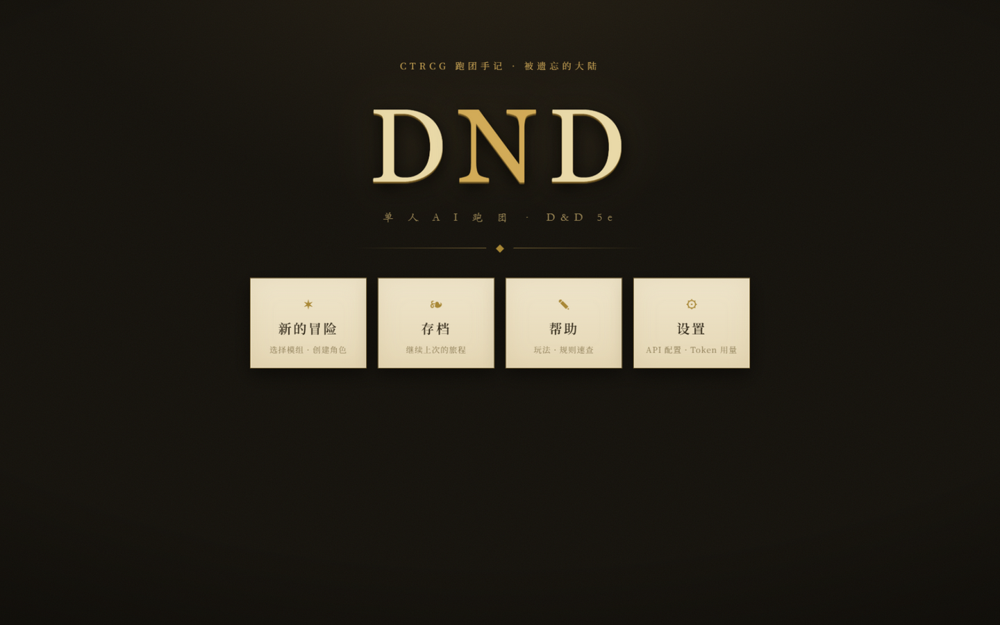
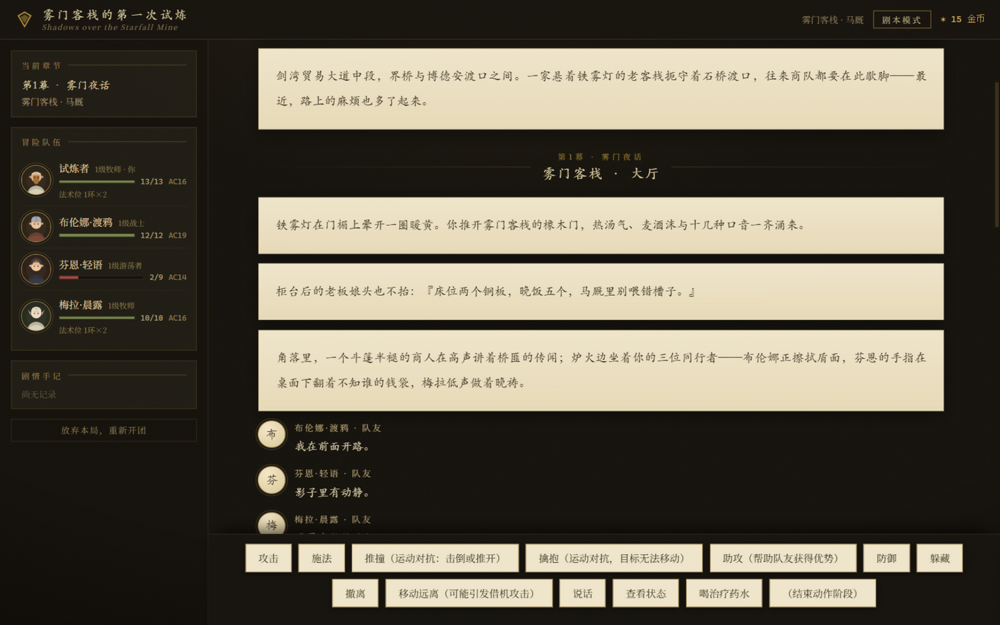
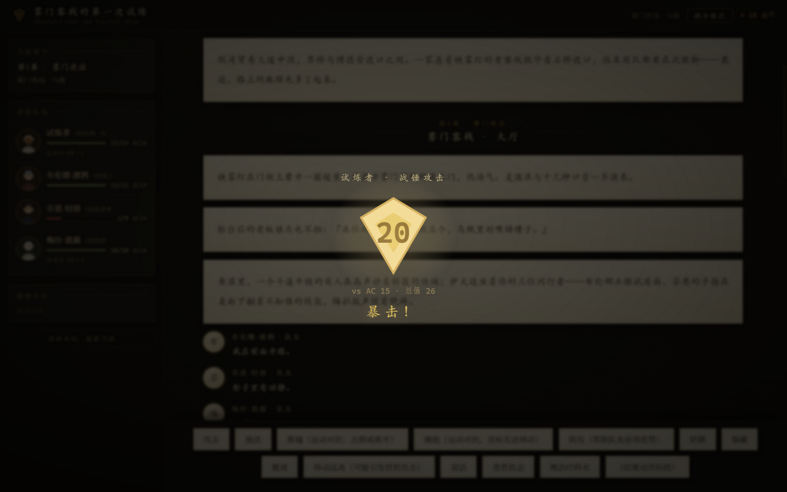
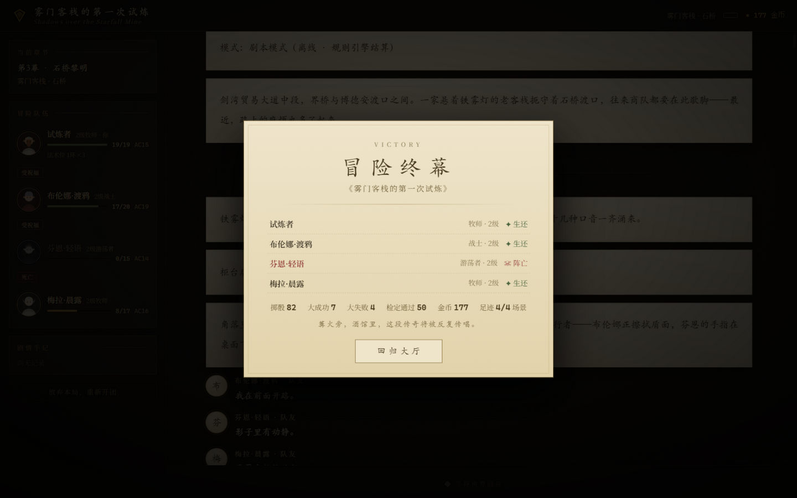

# CTRCG —— 单人 AI 跑团

一个可以**单人游玩**的 D&D 5e 跑团游戏（v1.0.0）。DM 和其他玩家角色（PC）由 AI Agent
扮演，故事发生在**被遗忘的大陆（Forgotten Realms）**的剑湾。

- **规则**：D&D 5e（SRD 5.1，PHB 2014 机制）——属性/技能/豁免、**完整动作经济
  （动作+附赠动作+反应）**、先攻、攻击与暴击、借机攻击、推撞/擒抱、法术位
  （满施法者/半施法者/**魔契法术位**）与专注、状态效果（含时限与再豁免）、
  死亡豁免与大伤害即死、力竭六级、短休/长休、经验与里程碑升级、
  **4 级属性提升（+2 单项或两项各 +1）**。
  所有骰点由规则引擎完成，LLM 只做决策与叙述，**不生成任何数值结果**。
- **演出**：每次检定与攻击都有 **d20 掷骰动画**（优势双骰、天然 20 金色爆辉、
  天然 1 震裂）；**合成音效**（骰子/命中/暴击/施法/升级/终局，Web Audio 实时
  生成，零外部音频文件）；队伍角色按种族×职业生成 **程序化头像**；
  升级华彩演出与**终幕结算卡**（同伴结局 + 掷骰统计）；首次开团有新手引导。
- **剧本**：预置五部原创模组——默认剧本
  《蓝望塔》（`blue-watch`，The Tower of the Blue Watch，改编自
  InternalRockStudio 的同名冒险素材：影林 → 夏叶旅店 → 蓝望塔）、
  《星坠矿脉的阴影》（`starfall`）、《盐雾灯塔的低语》（`saltmist`）、
  新手教学《雾门客栈的第一次试炼》（`mistgate`，边玩边学检定/潜行/黑暗/休整）、
  以及 **3→5 级终章战役《余烬之门》**（`embergate`，星坠矿脉的续篇：
  豺狼人/枭熊/尸妖/红帽子/相位蜘蛛/米诺陶/钻地魔虫/坎比翁轮番登场）。
  支持 **AI 一键生成模组**与**粘贴 JSON 导入**；开发规范见
  [MODULE_SPEC.md](MODULE_SPEC.md)（根目录）。
- **队友由剧本决定**：每个模组自带队友阵容；模组未定义时使用默认三人组。
- **桌边社交层（AI 模式）**：队友是桌边的活人——你的话音未落，他们可能
  **抢话**打断（终端 `（抢话）` 标记 / 网页"抢话"徽标）；DM 叙述后各自决定
  开口或沉默；意见相左时会进入多轮**辩论**（申辩/反驳/让步，直到有人闭嘴
  或被说服）；同伴们交谈过后，DM 会让 NPC 即席接话、反驳或裁定。战斗中
  队友也会先喊一句战吼再动手。LLM 不可达时整层静默降级，绝不阻塞对局。
- **Agent 循环**：参考 [deepseek-harness](https://github.com/deepseek-ai/deepseek-harness)
  的"一切皆插件"架构，详见 [HARNESS.md](HARNESS.md)。

## 界面预览

| 主页 | 对局 · 跑团手记 |
|---|---|
|  |  |

| d20 掷骰演出（天然 20 暴击） | 终幕结算卡 |
|---|---|
|  |  |

## 快速开始

要求：Python 3.10+，**无需安装任何第三方依赖**（零依赖、离线可玩）。

```bash
python main.py --web
# 或双击 启动游戏.bat（Windows）/ 启动游戏.sh（macOS/Linux）
# 打开 http://127.0.0.1:8500 （自动打开浏览器；--port 可改端口，--no-open 不自动打开）
```

> 第一次玩？选《雾门客栈的第一次试炼》——这部教学模组会手把手教你检定、
> 潜行突袭、黑暗与光源、短休长休和里程碑升级。

**开始页**：DND 标识下有四个入口——

- **新的冒险**：选择模组（内置三部 / AI 生成 / 导入的原子模组，Cordis 式注册表
  原子化加载），再创建角色开团；规范见根目录 [MODULE_SPEC.md](MODULE_SPEC.md)。
- **角色创建**（BG3 名单）：种族/职业/出身取自《博德之门3》
  （11 大族全部亚种、12 职业、11 个可选出身）；属性用 **4d6 去最低掷骰法**
  （服务端代掷、可重骰），种族加值按官方可选规则（Tasha's 万能起源）
  自选 **+2/+1 任意两项属性**；所有种族特性由引擎机制实现。
- **存档**：继续上次的旅程（存档记录所属模组，加载时自动匹配）。
- **帮助 / 设置**：玩法速查；API 配置（DeepSeek 默认 / 智谱 GLM / Kimi /
  MiniMax / 自定义，OpenAI 兼容协议；密钥只存内存或环境变量）；
  音效开关与音量（保存在本浏览器）；Token 用量记录（按 Agent 记账，
  持久化在 `saves/token_usage.json`）。

对局界面：左侧为章节、队伍状态（程序化头像、HP/AC/法术位/资源/状态）、剧情
手记；中央编年史以"跑团手记"风格呈现 DM 叙述、NPC 对话、骰子检定与战况板；
每次掷骰有全屏 d20 动画与音效；底部为行动按钮或自由输入框。刷新/断线自动回放
全部事件；"放弃本局"可重开；冒险结束（通关或全灭）进入终幕结算卡。

#### 接入 DeepSeek（DM 与 AI 队友）

最快路径：启动后到「设置 → API 配置」选 DeepSeek 并填入密钥，"测试连接"
通过即可开团；或用环境变量：

```bash
set CTRCG_LLM_BASE_URL=https://api.deepseek.com/v1
set CTRCG_LLM_API_KEY=sk-...
set CTRCG_LLM_MODEL=deepseek-chat
python main.py --web
```

服务端会为 DM 与模组队友分别构建 Agent（系统提示词 + 工具组），
经 harness 循环接入所选供应商。未配置时自动以剧本模式运行（离线可玩）。
`--offline` 可强制剧本模式。

### 终端版

```bash
python main.py --module saltmist --demo --seed 7  # 自动演示（机器人代打整部模组）
python main.py --new            # 剧本模式（离线）
python main.py --check-llm      # 验证 LLM 端点连通性
# 其他：--module ID 选模组；--load PATH 读档；--seed N 固定骰运
```

## 玩法（完整 5e 动作经济）

- 探索阶段：自由输入行动或对白（AI 模式），或按菜单选择检定/前进/休整；
  城镇与酒馆场景可逛**商店**（治疗药水/医疗包/火把，金币消费出口）。
  指令：`/状态 /背包 /短休 /长休 /喝药 /购买 /保存 /退出`。
- 战斗阶段：回合分**动作阶段**与**附赠动作阶段**两层菜单——
  - 动作：攻击（5 级武人自动攻击两次）、施法、推撞、擒抱、助攻、防御、
    躲藏、撤离、移动远离（会引发**借机攻击**）、喝药、圣疗、龙息、荒野变形；
  - 附赠动作：回气、狂暴、疾风连击、震慑拳、激励、双武器副手攻击，
    以及治疗真言/猎人印记/噬魂咒/迷踪步等带"附赠动作"标记的法术；
  - 反应：护盾术、灵活闪避、狱火斥喝、反制法术、借机攻击（自动或询问触发）。
- 规则要点（5e）：优势/劣势抵消、暴击骰翻倍（19-20 冠军/野蛮重击等扩展）、
  死亡豁免（3 成稳定/3 败身亡；**打倒你的一击不再多记失败**）、
  大伤害即死、专注法术受创需体质豁免、黑暗中无黑暗视觉攻击劣势
  （记得用火把/光亮术）、中毒/束缚/麻痹/震慑均有时限与再豁免。
- 短休：玩家自选消耗几颗生命骰（吟游诗人的休憩之歌 +1d6）；邪术师魔契
  法术位、武僧气、野变、引导神力等短休资源同时恢复。
- 物品：战斗中可饮用/喂服药水（治疗药水 2d4+2、上乘治疗药水 4d4+4，
  自动使用背包中药效最强者）；医疗包以动作稳定倒地队友（10 次用次，
  无需检定）；持有型魔法物品（余烬护符的火焰抗性）背在身上即生效；
  魔法武器拾取即同调（星坠矿脉的星炉长剑(+1) 攻击与伤害 +1）。
  尸妖的生命汲取会削减生命上限——长休才能恢复。
- 队友由 AI 代打（或剧本模式启发式 AI）：全 12 职业都有战斗思路——
  武僧疾风连击+震慑拳、德鲁伊野变扑咬、邪术师噬魂咒+魔能爆、
  圣武士圣疗+神佑斩……倒地的队友会有人喂药、包扎或治疗真言拉起。
- 里程碑升级：关键节点整队升级；2/3 级的战斗风格、子职业、魔契恩泽等
  由玩家交互选择（同伴按推荐默认）。

## 项目结构

```
ctrcg/
  rules/     # D&D 5e 完整引擎：dice / data(SRD数值+BG3名单) / character / combat
  campaign/  # 模组体系：module_data(内置数据) / loader(规范校验) / cordis(Context+Fiber 插件注册表)
  harness/   # Agent 核心：events(Session日志) / models / adapter / registry / loop+guards+compaction / usage(Token记账)
  game/      # 编排器、DM/PC Agent、游戏工具绑定、存档
  ui/        # 终端界面、角色创建、WebUI（SSE 事件流适配）
  web/       # 本地服务（HTTP+SSE）与前端（index.html / app.css / app.js）
modules/     # 原子模组目录（starfall 与 saltmist=内置；generated-*/imported-* 运行时产生）
MODULE_SPEC.md  # 剧本开发规范（根目录）
main.py      # 入口（--web / --module / --demo / --offline / --new / --load / --seed / --check-llm）
tests/       # 单元+集成测试（含 HTTP 驱动的完整剧本通关）
HARNESS.md   # Agent 核心循环与 deepseek-harness 的架构对照
```

## 测试

```bash
python -m unittest discover -s tests -v
```

覆盖：骰子与检定（含 4d6 掷骰法、半身人幸运重骰）、角色数值（BG3 加值分配/
无甲防御/黄金矮人坚韧/AC/熟练/三种施法表/休整/升级/力竭）、战斗机制
（先攻/动作经济/命中/暴击/法术/毒素 onhit/状态时限/借机攻击/死亡豁免/
大伤害即死/怪物 AI）、模组体系（JSON 规范校验、场景链、经验预算警告、
自定义怪物进战斗、Cordis 安装/删除/热加载与 requires 依赖生命周期）、
4 级 ASI（单项/两项/上限 20/非法形状）、物品通用化（上乘药水/医疗包
稳定/持有即生效机制）、野变状态显示、生命汲取长休恢复、死者不升级不回复、
复活后死亡豁免循环终止、启发式队友 AI 全职业一轮冒烟，《余烬之门》全流程
校验与多 seed 通关演示；harness（注册表校验、循环、guards、压缩、事件日志可重放、
端点 SSRF 校验、TokenMeter）、游戏集成（剧本模式整场战斗、里程碑升级、存档往返、
ScriptedAdapter 驱动的 DM/PC 决策路径）、Web 层（WebUI 阻塞应答、HTTP
端点、SSE 历史重放、设置校验、模拟 LLM 的模组生成、真实 HTTP 服务驱动的
整局通关）、三内置模组全流程校验（含教学模组三场遭遇与不可删除守卫）。

## 设计说明（规则口径）

- **战斗采用 5e 官方支持的剧场模式**（DMG 第 3 章 Theater of the Mind）：
  距离以近战/远程二分法处理，用"近身纠缠"近似 adjacency；
  借机攻击、撤离、推撞、擒抱在该模型下完整生效，不逐格移动。
- 施法者无需预配法术（掌握本职业全列表）；法术表覆盖 0-3 环常用法术，
  戏法 5 级自动升级、魔能爆 5 级双光束。
- 种族名单与出身沿用 BG3（即被遗忘的大陆正典种族）；属性加值采用
  官方可选规则（Tasha's 万能起源 / 2024 玩家手册）：任意两项 +2/+1。
- 怪物死亡即倒下（DMG 惯例）；PC 与队友走完整死亡豁免，**死亡需要复生
  魔法**——1-3 级内容范围内死亡的队友无法复活，玩家死亡即本局结束。
- 队员倒下（昏迷/稳定）会在场景切换时经"1d4 小时"照料恢复 1 HP 归队。

## 凭据与安全

- API Key 只从环境变量 `CTRCG_LLM_API_KEY` 读取，源码/示例中不出现任何真实凭据。
- LLM 端点默认禁止解析到私网/环回/链路本地地址（防 SSRF），本机模型服务需
  显式设置 `CTRCG_LLM_ALLOW_PRIVATE=1` 放行；重定向逐跳复检。

## 发行与许可

- 打包发行：`python build_release.py` → `dist/CTRCG-1.0.0.zip`（源码 + 启动器 +
  三部内置模组，解压即玩；接收方只需 Python 3.10+）。
- 许可：源代码以 [MIT](LICENSE) 许可发布；D&D 5e 规则内容改编自 WotC 的
  SRD 5.1（CC BY 4.0），已按要求声明归属；本项目非官方 D&D 产品。
  全部音画资产为运行时程序化合成（Web Audio / SVG），不含第三方文件。
- 变更历史见 [CHANGELOG.md](CHANGELOG.md)。
